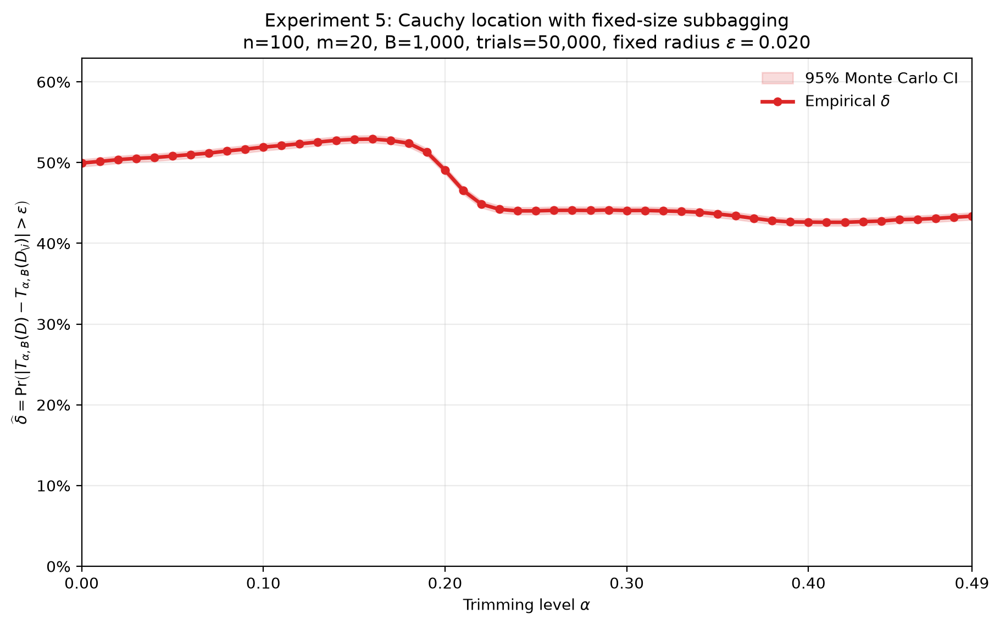
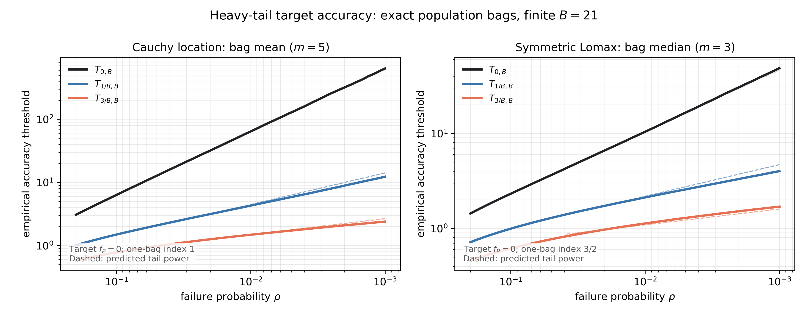
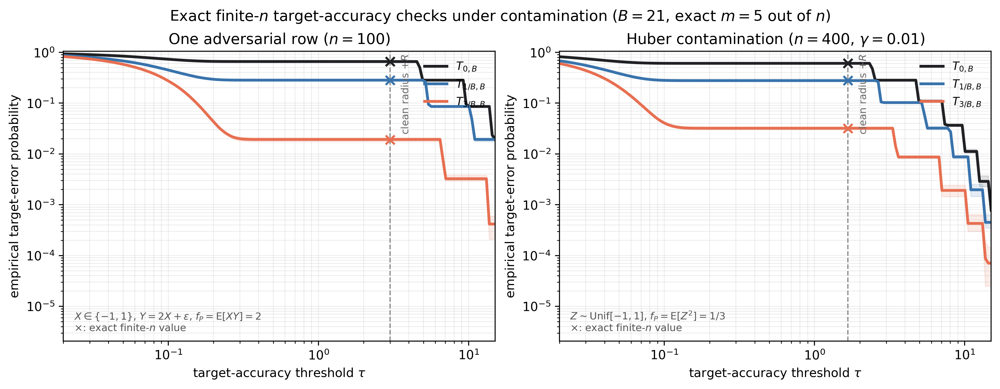

# SRIM: Trimmed-Mean Bagging Simulations

Python simulations and historical result figures from research on alpha-trimmed-mean bagging during Summer Research in Maths (SRIM), University of Cambridge, June–September 2026, supervised by Professor Po-Ling Loh.

The experiments study how aggregation affects sensitivity to deleting a training observation, estimation error under heavy tails and contamination, and the propagation of data perturbations through stochastic gradient descent. This repository collects the original simulation scripts and available results, with their experimental protocols identified separately.

## Selected results

### Leave-one-out stability under Cauchy data



The full-data and delete-one estimators share coupled randomness. Each bag samples a fixed-size subset without replacement. With n=100, m=20, B=1,000 and tolerance 0.02, the measured failure probability varies nonmonotonically with the trimming level. Trimming does not uniformly improve the empirical LOO profile.

### Target accuracy under heavy tails



For Cauchy location estimation with independent population bags, m=5 and B=21, the recorded 99th percentile of absolute error decreases from 64.1313 at alpha=0 to 1.4859 at alpha=3/21. This is an estimation-error quantile, not a finite-n LOO stability measurement or a variance reduction.

### Target accuracy under contamination



| Recorded metric | Mean aggregation, alpha=0 | Trimmed aggregation, alpha=3/21 |
| --- | ---: | ---: |
| Cauchy location: 99th percentile absolute error | 64.1313 | 1.4859 |
| One-row adversarial contamination: P(absolute error > 3) | 65.8771% | 1.9304% |
| Huber second-moment estimation: P(absolute error > 5/3) | 60.6908% | 3.2033% |

These values are taken from the committed JSON summaries. The Cauchy experiment uses 2,400,000 population ensembles per model. Each contamination experiment uses 240,000 replications, m=5 and B=21. The adversarial setting uses n=100 with one replaced row; the Huber setting uses n=400 and a 1% contamination probability.

## Experiments

| Script | Model or comparison | Main settings | Protocol |
| --- | --- | --- | --- |
| `simulations/experiment1_gaussian_mean.py` | Gaussian sample mean | n=100, m=20, B=1,000; 50,000 trials; tolerance 0.005 | Shared-coupling LOO |
| `simulations/experiment2_gaussian_median.py` | Gaussian sample median | n=100, m=21, B=1,000; 50,000 trials; tolerance 0.01 | Shared-coupling LOO |
| `simulations/experiment3_gaussian_regression.py` | OLS prediction at x=0.5 | n=100, m=20, B=1,000; 50,000 trials; tolerance 0.05 | Shared-coupling LOO |
| `simulations/experiment4_adversarial_median.py` | Contaminated uniform data, bag median | n=100, m=21, B=1,000; 30% replaced rows; 50,000 trials; tolerance 0.05 | Shared-coupling LOO |
| `simulations/experiment5_cauchy_mean.py` | Cauchy sample mean | n=100, m=20, B=1,000; 50,000 trials; tolerance 0.02 | Shared-coupling LOO |
| `simulations/experiment6_adversarial_mean.py` | Contaminated uniform data, bag mean | n=100, m=21, B=500; 10% replaced rows; 20 runs of 10,000 trials; tolerance 0.05 | Shared-coupling LOO |
| `sgd/experiment7_common_coupling_stability_n1000.py` | Trimmed bag gradients, ordinary SGD, weighted-averaged SGD | n=1,000, d=10, m=50, B=250, alpha=0.10; 300 trials; 99 updates | Shared-coupling LOO on one fixed dataset |
| `simulations/heavy_tail_accuracy.py` | Cauchy bag means and symmetric-Lomax bag medians | B=21; 2,400,000 ensembles per model | Population target accuracy |
| `simulations/target_accuracy_contamination.py` | Adversarial regression moment and Huber second moment | m=5, B=21; 240,000 replications | Finite-n target accuracy with exact probability comparisons |
| `simulations/finite_B_stability.py` | Historical heavy-tail and contamination comparisons | Settings recorded in `finite_B_summary.json` | Independent-run comparisons; separate from shared-coupling LOO |

The scalar LOO experiments scan alpha=0, 0.01, ..., 0.49 and plot normal-approximation 95% Monte Carlo confidence intervals. The SGD experiment compares the same number of updates; trimmed updates evaluate B*m gradients, so its results are not a comparison at equal computational cost.

## Run the simulations

Use Python 3.10 or newer:

```bash
python -m venv .venv
source .venv/bin/activate
python -m pip install -r requirements.txt

python simulations/experiment5_cauchy_mean.py
python simulations/heavy_tail_accuracy.py --output-dir runs/heavy-tail
python simulations/target_accuracy_contamination.py --output-dir runs/contamination
python sgd/experiment7_common_coupling_stability_n1000.py
```

The original scalar LOO and SGD scripts use configuration constants at the top of each file and save PNGs beside the scripts. Running their defaults can overwrite the corresponding historical figure. Copy a script to a separate working directory before experimenting with its settings. The CLI-based scripts accept `--output-dir`; use a separate output directory to preserve the archived results. Experiment 6 generates 20 run-specific PNGs.

For a quick execution check of the target-accuracy scripts:

```bash
python simulations/heavy_tail_accuracy.py --replications 12000 --blocks 12 --chunk-size 1000 --output-dir runs/smoke-heavy-tail
python simulations/target_accuracy_contamination.py --replications 1200 --blocks 12 --batch-size 100 --output-dir runs/smoke-contamination
```

Small runs check execution and produce noisy exploratory curves; they do not reproduce the committed full-run numerical results. Original fixed seeds are preserved. Exact bitwise reproduction across library versions and platforms is not guaranteed.

## Result provenance

See [the result index](docs/RESULTS.md) for figure-to-script mappings and historical variants, and [the artifact manifest](docs/artifact_manifest.json) for file sizes and SHA-256 hashes.

All ten Python scripts and all figure files are preserved byte for byte from the local research archive. In `heavy_tail_accuracy_summary.json`, two machine-specific output paths were replaced with repository-relative paths; its recorded numbers are unchanged. Earlier figures with different settings are retained even where the matching historical source revision is unavailable. The repository does not include raw trial-level samples, a theoretical manuscript, or application documents.

## Research context

The motivating paper is Soloff, Foygel Barber and Willett, [Bagging Provides Assumption-free Stability](https://jmlr.org/papers/v25/23-0536.html), JMLR, 2024. The simulations here investigate trimmed aggregation and distinguish shared-randomness LOO sensitivity, independent-run variation, and target-estimation accuracy. Experimental improvements are specific to the displayed models and settings.
