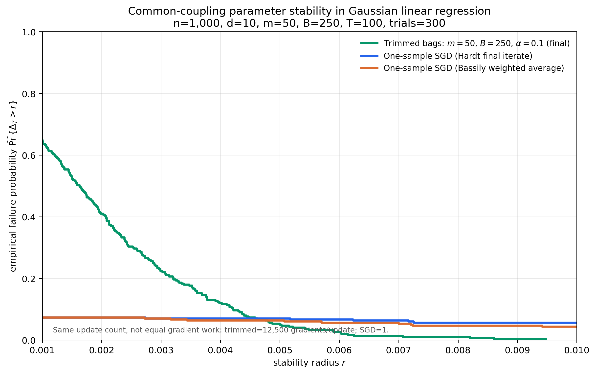

# Cambridge SRIM Research on Trimmed Mean Bagging

Simulation code and selected results from Summer Research in Maths at the University of Cambridge, June–September 2026, supervised by Professor Po-Ling Loh. The project investigates how alpha-trimmed aggregation affects leave-one-out sensitivity, heavy-tail estimation accuracy, contamination robustness and stochastic gradient descent.

## Repository layout

```text
code/             Nine Python experiment scripts
results/          Nine selected historical PNG figures
README.md         Research report, experiment index and running instructions
requirements.txt  Python dependencies
```

Scripts and figures share experiment numbers 01–09. Figure names identify the metric, model and relevant settings: `loo` means leave-one-out sensitivity, `accuracy` means estimation error, `epsilon` is the tolerance and `gamma` is the row contamination fraction. Decimal points in filenames are written as `p`; for example, `0p05` means 0.05. `B` denotes the number of bags, `m` their size, `n` the dataset size, `d` the output dimension and `alpha` the trimming fraction on each side.

## Short research report

### Research question and method

Ordinary bagging averages predictions across resampled datasets. Alpha-trimmed-mean bagging sorts the bag outputs, removes a fraction alpha from each tail and averages the center. Fractional boundary weights implement the quantile-integral definition when alpha times B is not an integer. At alpha=0, the aggregate is the ordinary mean.

Experiments 01–06 estimate the probability that deleting one randomly selected observation changes the aggregate by more than epsilon. Full-data and delete-one runs share coupled randomness: a bag that does not contain the deleted row has identical reports on both sides. Each bag samples a fixed-size subset without replacement. The simulations scan alpha=0, 0.01, ..., 0.49 and plot normal-approximation 95% Monte Carlo confidence intervals.

Experiment 07 applies shared coupling to SGD on a fixed Gaussian regression dataset. Experiments 08–09 instead measure error relative to a population or clean-data target. These accuracy measurements answer a different question from LOO sensitivity.

### Leave-one-out results


The Cauchy sample-mean experiment shows a nonmonotonic response to trimming: the plotted failure probability is approximately 50% at alpha=0, rises to about 53% for some smaller trimming levels and falls to about 43% at larger levels. These approximate readings show why trimming should be assessed under a specified data model and tolerance, rather than assumed to improve every LOO profile.

The other scalar experiments compare Gaussian means, Gaussian medians, OLS predictions, and means or medians under fixed-row contamination. Their individual figures are linked in the experiment index below. For experiment 06, the selected figure is the original first indexed run, chosen without screening its outcome. The source still generates all 20 independent runs.

### SGD comparison



The SGD figure compares coordinatewise trimmed bag gradients, ordinary one-sample SGD and step-size-weighted averaged SGD. It uses n=1,000, d=10, m=50, B=250, alpha=0.10 and 300 trials, recording 100 iterates including initialization, hence 99 updates. The curves cross as the tolerance changes. This is an exploratory comparison at equal update counts: a trimmed update evaluates 12,500 gradients, while a one-sample update evaluates one. It does not establish an advantage at equal computational cost.

### Accuracy under heavy tails and contamination


| Recorded metric | Mean aggregation, alpha=0 | Trimmed aggregation, alpha=3/21 |
| --- | ---: | ---: |
| Cauchy location: 99th percentile absolute error | 64.1313 | 1.4859 |
| One-row adversarial contamination: P(absolute error > 3) | 65.8771% | 1.9304% |
| Huber second moment: P(absolute error > 5/3) | 60.6908% | 3.2033% |

Experiment 08 draws 2,400,000 independent population-bag ensembles per model, with B=21. The Cauchy model uses bag means with m=5 and target location 0; a second model uses symmetric-Lomax data and bag medians with m=3. The Cauchy absolute-error quantile falls substantially with trimming; it is not a variance measurement, and the Cauchy mean has no finite variance.

Experiment 09 uses 240,000 replications per setting, m=5 and B=21. The adversarial model has n=100, clean X in {-1,1}, Y=2X+Uniform(-1,1), target 2, and one row replaced by (1,500). The Huber model has n=400, clean Z distributed uniformly on [-1,1], target second moment 1/3, and a 1% mixture probability of replacement by Z=16.

Exact finite-n error probabilities provide a check: in the adversarial setting they are 65.9438% and 1.8881% for alpha=0 and 3/21; in the Huber setting they are 60.6556% and 3.1727%. They are close to the recorded Monte Carlo estimates. These results demonstrate improvements in the displayed estimation-error metrics, not a universal stability guarantee.

## Experiment index

Each result link opens the corresponding original PNG.

| No. | Code | Selected result | Default configuration |
| --- | --- | --- | --- |
| 01 | [Gaussian mean](code/01_loo_gaussian_mean.py) | [LOO, epsilon=0.005](results/01_loo_gaussian_mean_epsilon_0p005.png) | n=100, m=20, B=1,000; 50,000 trials |
| 02 | [Gaussian median](code/02_loo_gaussian_median.py) | [LOO, epsilon=0.01](results/02_loo_gaussian_median_epsilon_0p01.png) | n=100, m=21, B=1,000; 50,000 trials |
| 03 | [Gaussian regression](code/03_loo_gaussian_regression.py) | [LOO, epsilon=0.05](results/03_loo_gaussian_regression_epsilon_0p05.png) | n=100, m=20, B=1,000; 50,000 trials; prediction at x=0.5 |
| 04 | [Contaminated median](code/04_loo_contaminated_median.py) | [LOO, gamma=0.3, epsilon=0.05](results/04_loo_contaminated_median_gamma_0p3_epsilon_0p05.png) | n=100, m=21, B=1,000; 50,000 trials; replaced values=10 |
| 05 | [Cauchy mean](code/05_loo_cauchy_mean.py) | [LOO, epsilon=0.02](results/05_loo_cauchy_mean_epsilon_0p02.png) | n=100, m=20, B=1,000; 50,000 trials |
| 06 | [Contaminated mean](code/06_loo_contaminated_mean.py) | [LOO, gamma=0.1, epsilon=0.05, run 01](results/06_loo_contaminated_mean_gamma_0p1_epsilon_0p05_run_01.png) | n=100, m=21, B=500; 20 runs of 10,000 trials; replaced values=10 |
| 07 | [SGD comparison](code/07_loo_sgd.py) | [Shared-coupling LOO](results/07_loo_sgd_n1000_d10_m50_B250_alpha_0p1.png) | n=1,000, d=10, m=50, B=250, alpha=0.10; 300 trials |
| 08 | [Heavy-tail accuracy](code/08_accuracy_heavy_tails.py) | [Population target error](results/08_accuracy_heavy_tails_B21.png) | B=21; 2,400,000 ensembles per model |
| 09 | [Contamination accuracy](code/09_accuracy_contamination.py) | [Finite-n clean-target error](results/09_accuracy_contamination_B21_m5.png) | m=5, B=21; 240,000 replications per setting |

## Run the experiments

Use Python 3.10 or newer:

```bash
python -m venv .venv
source .venv/bin/activate
python -m pip install -r requirements.txt

python code/05_loo_cauchy_mean.py
python code/07_loo_sgd.py
python code/08_accuracy_heavy_tails.py --output-dir runs/heavy-tail
python code/09_accuracy_contamination.py --output-dir runs/contamination
```

All scripts save PNGs in `results/` by default. Running the defaults can overwrite the selected historical figures. Scripts 01–07 use configuration constants near the top of each file; change their output path or directory for exploratory runs. Scripts 08–09 accept `--output-dir` and print their numerical summaries to standard output, without creating PDF or JSON files.

For quick execution checks:

```bash
python code/08_accuracy_heavy_tails.py --replications 12000 --blocks 12 --chunk-size 1000 --output-dir runs/smoke-heavy-tail
python code/09_accuracy_contamination.py --replications 1200 --blocks 12 --batch-size 100 --output-dir runs/smoke-contamination
```

Seeds and simulation algorithms are retained from the research archive; filenames, output paths and export formats were adapted for this layout. Selected PNG contents are unchanged. Earlier parameter variants, repeated run figures, independent-run comparisons and figures without matching source revisions are omitted from the current presentation and remain recoverable in Git history. The numerical results above were transcribed from the historical summaries before consolidating the documentation.

All nine scripts were checked with reduced simulation counts, including PNG generation and output-name consistency. These execution checks do not reproduce the historical full-run estimates. Exact results may vary across library versions and platforms.

Research background: Soloff, Foygel Barber and Willett, [Bagging Provides Assumption-free Stability](https://jmlr.org/papers/v25/23-0536.html), JMLR, 2024.
